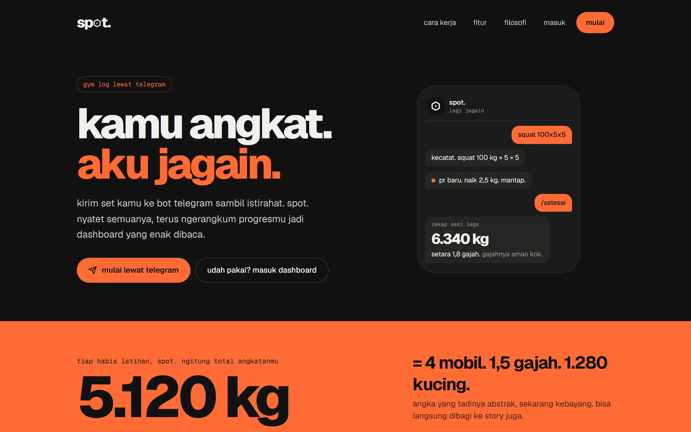
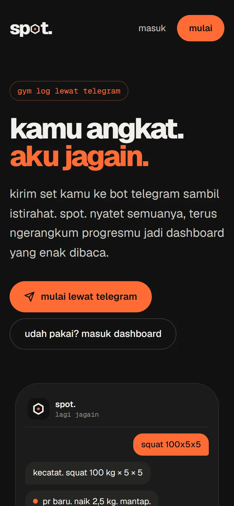
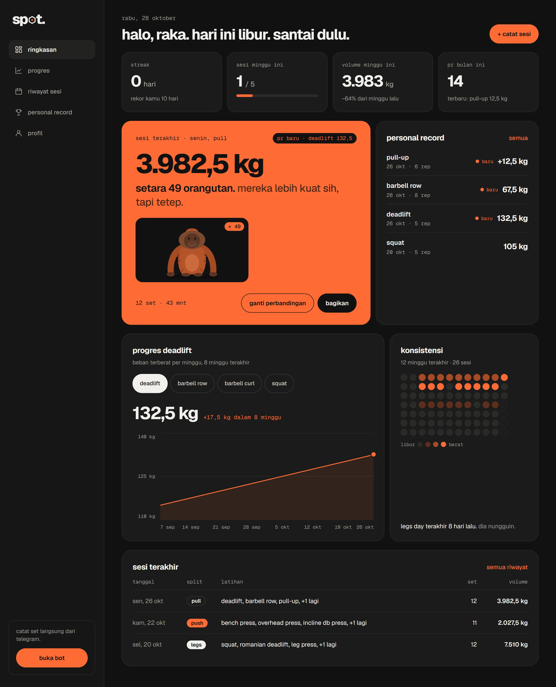
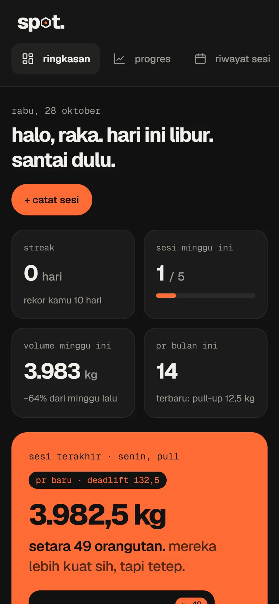
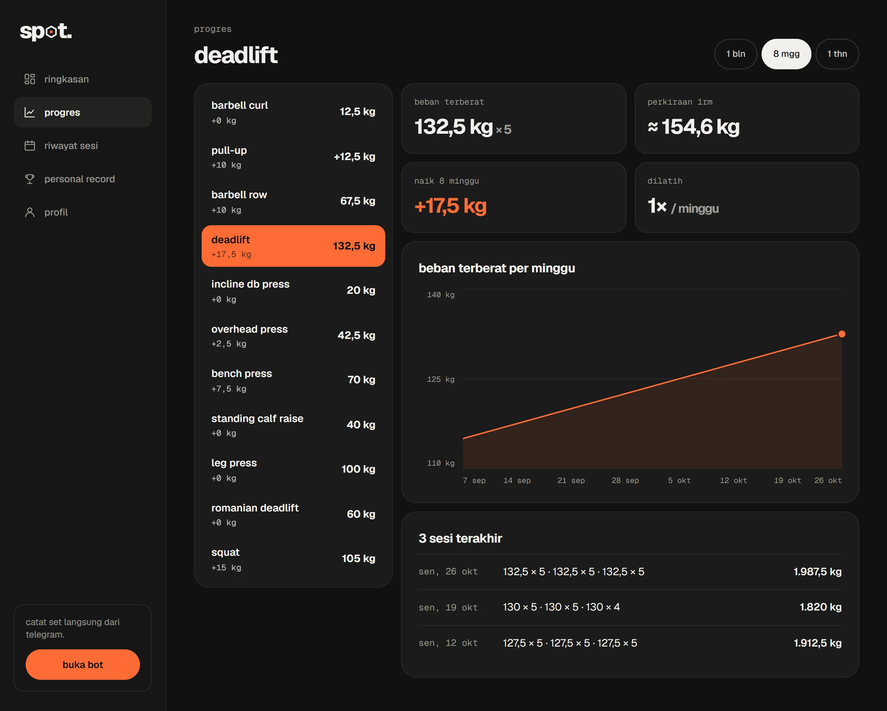
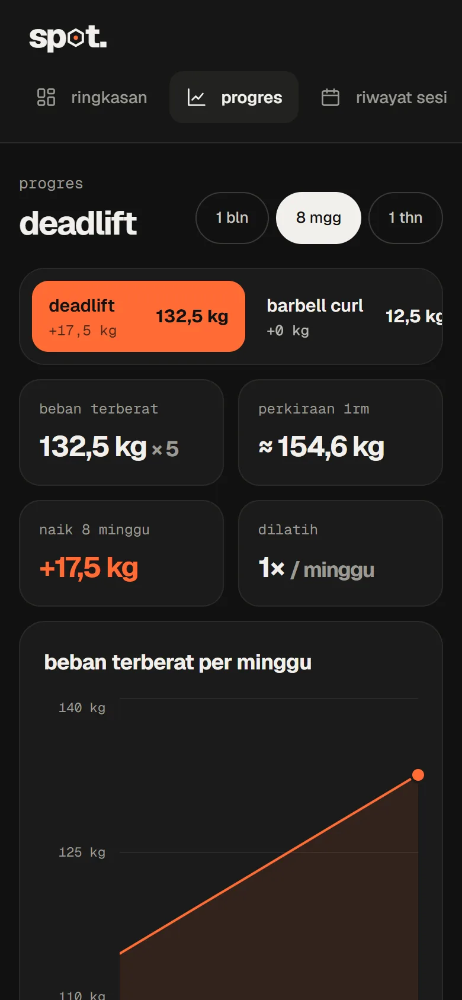
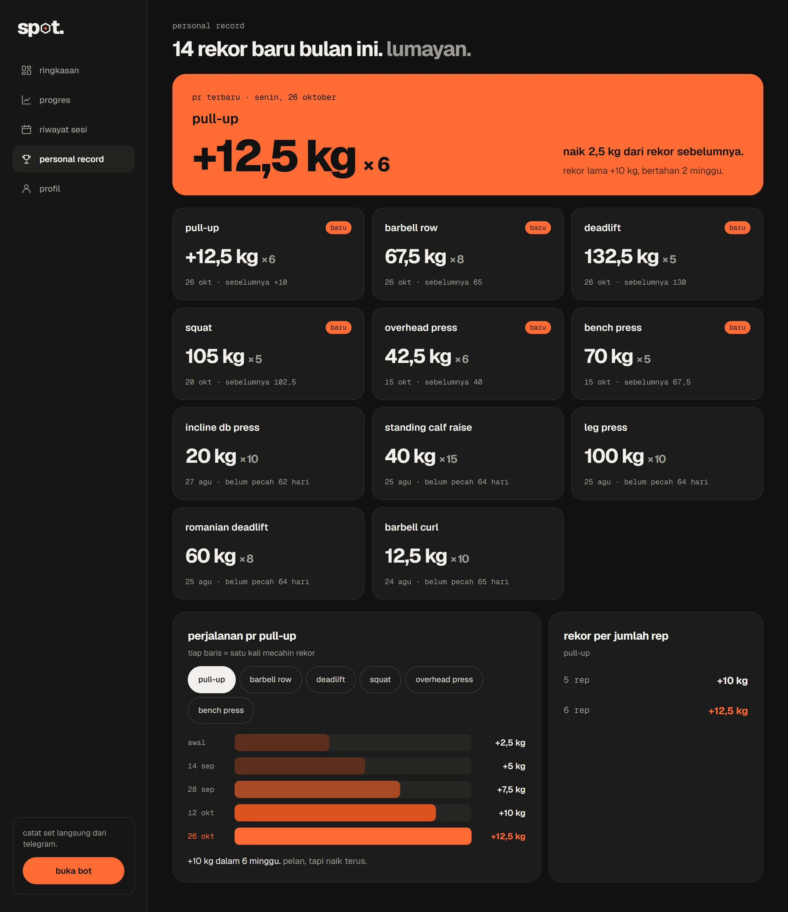
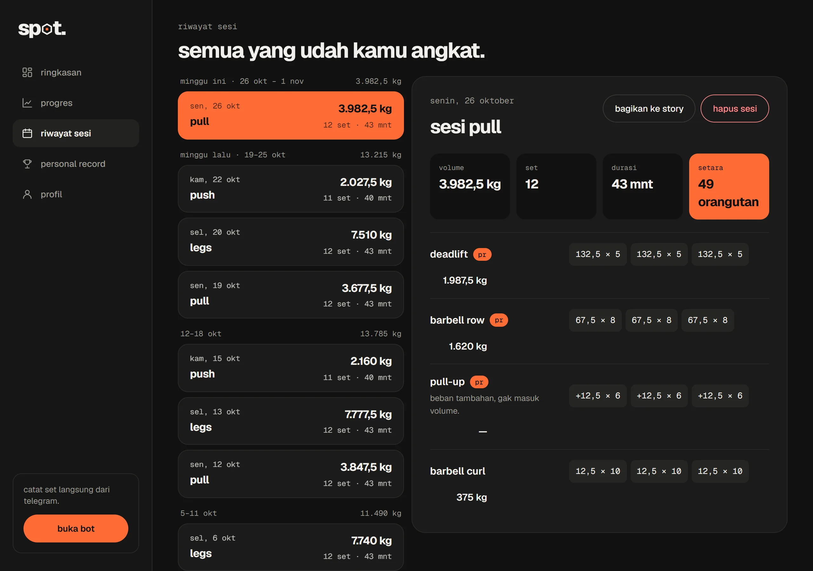

<div align="center">

# spot.

### kamu angkat. aku jagain.

**gym log lewat chat telegram.** catat tiap set sambil istirahat, cukup tekan satu tombol.<br>
progres, pr, dan streak-mu dirangkum jadi dashboard web yang enak dibaca.


**[coba jalankan →](#-coba-jalankan)**

[fitur](#-fitur) · [tangkapan layar](#-tangkapan-layar) · [coba jalankan](#-coba-jalankan) · [di balik layar](#-di-balik-layar) · [privasi](#-privasi)

<br>


&nbsp;


</div>

<br>

## ✦ kenapa spot.?

Buka aplikasi gym di sela set itu ribet: cari latihannya, ketik angka satu-satu, tangan masih gemetar. **spot.** pindahin semua itu ke chat Telegram yang memang udah kebuka. Bot-nya, **spotter**, nyiapin kartu latihan yang angkanya udah keisi dari minggu lalu. Kamu tinggal tekan **✅ catat**.

| | |
| --- | --- |
| 🏋️ **kartu latihan** | satu kartu per latihan yang diedit di tempat, angka dari sesi sebelumnya, tombol ± beban & rep, dan **✅ catat** |
| ⌨️ **ketik cepat** | `6`, `70 8`, `ok`, `-`, atau `bench 70x8x3`. Nama latihan dibaca longgar, typo dan singkatan tetap kenal |
| ⏱️ **pengingat istirahat** | 90 detik setelah set dicatat, hp bunyi sekali. Pesannya hilang sendiri begitu kamu lanjut |
| 🏆 **pr & rekap** | pr langsung dikabari, satu pesan rekap tiap selesai latihan, lengkap dengan perbandingan sesi sebelumnya |
| 🐘 **setara dengan** | total angkatan dibandingin ke benda sehari-hari: *"setara 49 orangutan. mereka lebih kuat sih, tapi tetep."* |
| 📊 **dashboard web** | grafik progres, kalender konsistensi, riwayat yang bisa diedit, dan kartu Story siap dibagikan |

<br>

## ✦ tangkapan layar

**Ringkasan.** Streak, volume minggu ini, sesi terakhir yang disetarakan dengan benda, pr terbaru, dan kalender 12 minggu.

<p align="center">

&nbsp;

</p>

**Progres.** Pilih latihan, lihat beban terberat per minggu dan perkiraan 1RM.

<p align="center">

&nbsp;

</p>

<details>
<summary><b>personal record & riwayat sesi</b></summary>

<p align="center">


</p>

</details>

<details>
<summary><b>kartu latihan di bot</b></summary>

```
🏋️ bench press · set 2 dari 3
push · latihan 1 dari 5 hari ini
minggu lalu set 2 kamu 72,5 kg × 6, udah aku isi di bawah.
➡️ 72,5 kg × 6
hari ini: ✅ 75×5
set 1 kecatat, sama persis kayak minggu lalu.

[➖ 2,5 kg]            [➕ 2,5 kg]
[➖ 1 rep]             [➕ 1 rep]
[✅ catat 72,5 kg × 6]
[↩️ hapus set terakhir]
[➡️ latihan berikutnya]
[🔄 ganti latihan]     [🏁 selesai latihan]
```

</details>

<br>

## ✦ fitur

<details open>
<summary><b>bot telegram</b></summary>

- **kenalan 1 menit**: pilih program (ppl, upper lower, full body, ppl + upper lower, atau atur sendiri) dan hari latihan, lalu latihan coba 30 detik tanpa data tersimpan
- **jadwal cuma saran**: tekan 🏋️ kartu latihan, split jadwal hari ini paling atas, tapi split lain tetap bisa dipilih
- daftar latihan rekomendasi per split, urutannya bebas. Butuh yang lain? 🔍 cari dari **268 gerakan** per otot, atau ketik namanya
- beban, berat badan (+ beban tambahan), durasi, dan kardio (waktu + jarak), masing-masing dengan tombol yang pas
- reaksi tiap set dibanding minggu lalu, *"masih ada n yang belum"*, dan 🎉 saat semua latihan hari ini beres
- **↩️ hapus set terakhir** tanpa konfirmasi, lengkap dengan **↩️ urungkan**
- `/kemarin` buat nyatet yang kelewat, `/libur` dan `/geser` buat jadwal, `/pr bench` buat lihat rekor
- pengingat latihan, *"kemarin kelewat"*, dan rekap mingguan otomatis. Bisa disetel jadi **seperlunya** kalau mau bot yang lebih kalem

</details>

<details open>
<summary><b>streak yang adil</b></summary>

- streak ikut **jadwal**, bukan hari kalender: hari yang bukan jadwal latihan tidak memutus streak
- ada **jatah libur** per minggu (bawaan 1), jadi sakit atau capek sekali nggak bikin streak hangus
- kalender konsistensi 12 minggu di dashboard

</details>

<details open>
<summary><b>dashboard web</b></summary>

| halaman | isi |
| --- | --- |
| **ringkasan** | streak, sesi & volume minggu ini, pr bulan ini, kartu setara, grafik progres, kalender, sesi terakhir |
| **progres** | beban terberat per minggu, e1RM, dan 3 sesi terakhir per latihan |
| **riwayat** | sesi per minggu; tiap set bisa diedit atau dihapus, dan hapus bisa diurungkan 10 detik |
| **pr** | pr terbaru, semua rekor, perjalanan pr, dan rekor per jumlah rep |
| **profil** | program & jadwal, template latihan per split, jatah libur, jam pengingat, satuan kg/lb, ekspor csv, hapus akun |

</details>

<details open>
<summary><b>setara & kartu Story</b></summary>

| kelompok | benda |
| --- | --- |
| **ringan** | durian · kucing · galon air · karung beras |
| **menengah** | kulkas · komodo · orangutan · motor matic · piano · sapi bali |
| **berat** | badak sumatera · mobil · gajah sumatera · paus biru |

- benda dipilih otomatis supaya angkanya masuk akal (1–50×), atau dikunci di profil
- kartu Story 1080×1920 dalam 3 gaya: **oranye**, **gelap**, dan **kapur**, dikirim bot sebagai gambar saat rekap

</details>

<br>

## ✦ coba jalankan

Untuk menjalankan versimu sendiri, siapkan Node.js 20.9+, project [Supabase](https://supabase.com) gratis, dan token bot dari [@BotFather](https://t.me/BotFather). Di komputer, bot jalan pakai long polling; untuk dipakai sehari-hari, deploy ke Vercel (lihat di bawah).

```bash
git clone https://github.com/masigoooel/spot---gym.git
cd spot---gym
npm install
cp .env.example .env.local   # isi token bot & key supabase
npm run dev                  # web: http://localhost:3000
npm run bot                  # bot telegram (long polling), di terminal lain
```

| perintah | gunanya |
| --- | --- |
| `npm run dev` | web mode development |
| `npm run bot` | jalankan bot lokal pakai long polling (menolak jalan kalau webhook server terpasang) |
| `npm run webhook -- <alamat>` | pasang bot ke server: Telegram mengirim pesan ke `<alamat>/api/telegram` |
| `npm run webhook -- hapus` | lepas webhook, supaya bot bisa dijalankan lokal lagi |
| `npm run build` | build production |
| `npm start` | jalankan hasil build |
| `npm run lint` | ESLint |
| `npm test` | unit test parser, logika latihan, streak, setara (Vitest) |

<details>
<summary><b>siapkan database</b></summary>

1. buat project baru di [supabase.com](https://supabase.com)
2. buka **SQL Editor**, lalu jalankan isi `supabase/migrations/` berurutan dari `0001` sampai `0009`
3. jalankan `supabase/seed.sql` untuk mengisi daftar 268 gerakan dan template latihan per split
4. salin **Project URL** dan **service role key** dari **Project Settings → API** ke `.env.local`

</details>

<details>
<summary><b>environment variables</b></summary>

| variabel | wajib | keterangan |
| --- | --- | --- |
| `TELEGRAM_BOT_TOKEN` | ya | token dari @BotFather |
| `NEXT_PUBLIC_BOT_USERNAME` | ya | username bot tanpa `@`, untuk link "buka bot" |
| `NEXT_PUBLIC_SUPABASE_URL` | ya | Project URL Supabase |
| `SUPABASE_SERVICE_ROLE_KEY` | ya | service role key, **hanya dipakai di server** |
| `SESSION_SECRET` | ya | minimal 32 karakter, untuk cookie sesi dashboard |
| `NEXT_PUBLIC_APP_URL` | tidak | lokal: `http://localhost:3000`. Di Vercel kosongkan, alamat produksi terbaca otomatis |
| `TELEGRAM_WEBHOOK_SECRET` | ya, di server | teks acak; Telegram mengirimnya di header supaya `/api/telegram` hanya menerima dari Telegram |
| `CRON_SECRET` | ya, di server | teks acak; dicek di setiap panggilan `/api/cron` |

> 🔒 Service role key dan token bot hanya dipakai di server, tidak pernah dikirim ke browser. `.env.local` sudah diabaikan git.

</details>

<details>
<summary><b>deploy ke Vercel</b></summary>

1. push repo ke GitHub
2. di [vercel.com](https://vercel.com), pilih **Add New → Project** lalu import repo-nya
3. di **Environment Variables**, isi semua variabel di atas kecuali `NEXT_PUBLIC_APP_URL`
4. klik **Deploy**. Setiap push ke `main` otomatis di-deploy ulang
5. pasang bot ke server: `npm run webhook -- https://<alamat-app>.vercel.app`
6. jadwalkan cron: isi `<ALAMAT_APP>` dan `<CRON_SECRET>` di `supabase/cron.example.sql`, lalu jalankan di SQL Editor Supabase. `pg_cron` memanggil `/api/cron` tiap 30 detik untuk pengingat latihan, rekap mingguan, dan pengingat istirahat

Function berjalan di region `hnd1` (Tokyo, lihat `vercel.json`). Samakan dengan region project Supabase-mu supaya bot tetap cepat.

</details>

<details>
<summary><b>masuk ke dashboard</b></summary>

Tidak ada password. Kirim `/masuk` ke bot, lalu buka link sekali pakai yang dikirimnya. Selama masih lokal, link-nya ditulis sebagai teks karena Telegram menolak tombol ke `localhost`.

</details>

<br>

## ✦ di balik layar

| bagian | teknologi |
| --- | --- |
| framework | Next.js 16 (App Router, Turbopack) + React 19 + TypeScript |
| styling | Tailwind CSS v4 · font Geist & Geist Mono |
| database | Supabase (Postgres), diakses hanya dari server |
| bot | grammY: webhook `/api/telegram` di Vercel, long polling saat lokal |
| jadwal | `pg_cron` + `pg_net` di Supabase → `/api/cron` tiap 30 detik |
| login | link sekali pakai dari bot → cookie sesi terenkripsi (iron-session) |
| gambar | `next/og` untuk kartu Story & rekap |
| kualitas | ESLint · Vitest · TypeScript strict |

1. pesan dan tombol masuk ke handler bot di `lib/bot/`, yang sama untuk webhook di server dan long polling di komputer
2. state bot (kartu aktif, draft angka, latihan yang dilewati, pengingat istirahat) disimpan di database, bukan di memori, jadi aman di serverless
3. tombol yang mencatat bersifat **idempotent**: ditekan dua kali cepat tetap jadi satu set
4. hapus memakai *soft delete*, lalu volume, pr, dan streak dihitung ulang, jadi semua bisa diurungkan

<details>
<summary><b>struktur folder</b></summary>

```
app/
├─ (publik)/page.tsx          landing
├─ masuk/                     login lewat link dari bot
├─ dashboard/                 ringkasan, progres, riwayat, pr, profil
├─ bagikan/[sessionId]/       pratinjau & bagikan kartu Story
└─ api/
   ├─ telegram/               webhook bot
   ├─ cron/                   pesan terjadwal & pengingat istirahat (dipanggil pg_cron)
   └─ story/                  gambar kartu Story (next/og)
bot/
├─ dev.ts                     jalankan bot lokal (long polling) + pesan terjadwal
└─ webhook.ts                 pasang / lepas webhook ke server
lib/
├─ bot/                       handler bot: kenalan, kartu, cari, hapus, rekap, jadwal, istirahat
├─ copy.ts                    semua teks bot di satu tempat
├─ parser.ts                  baca pesan set (`bench 70x8x3`, `6`, `ok`) + unit test
├─ exercise-match.ts          pencocokan nama latihan yang longgar
├─ workout.ts · stats.ts      volume, top set, pr, e1RM, streak
├─ setara.ts                  "setara dengan" + benda pembanding
└─ story.tsx                  kartu Story
supabase/
├─ migrations/                skema database, dijalankan berurutan
├─ seed.sql                   268 gerakan + template latihan per split
└─ cron.example.sql           jadwal pg_cron setelah deploy
```

</details>

<details>
<summary><b>kustomisasi</b></summary>

- **teks bot**: semua kalimat ada di `lib/copy.ts`
- **benda setara**: tambah atau ubah di `lib/setara.ts`
- **daftar gerakan & template split**: ubah `supabase/seed.sql`, lalu jalankan ulang (aman dijalankan berkali-kali)
- **warna brand**: token `--spot-*` di `app/globals.css`

</details>

<br>

## ✦ privasi

> Datamu disimpan di database Supabase milikmu sendiri. Tidak ada iklan, tidak ada pelacak.

- bot hanya membaca pesan di chat pribadi dengannya, tidak di grup
- login dashboard tanpa password: link sekali pakai dari bot, lalu cookie sesi terenkripsi
- semua akses database lewat server; key Supabase tidak pernah sampai ke browser
- data bisa diekspor ke csv kapan saja, dan **hapus akun** menghapus semuanya setelah jeda 7 hari (bisa dibatalkan selama jeda itu)

<br>

## ✦ catatan & kredit

- pengingat istirahat dicek tiap 30 detik oleh cron, jadi datang 90–120 detik setelah set dicatat
- satu token bot cuma bisa dipakai satu tempat: webhook di server **atau** long polling di komputer
- berat benda di fitur setara itu perkiraan rata-rata, cukup untuk hiburan
- font [Geist](https://vercel.com/font) oleh Vercel, SIL Open Font License

<details>
<summary><b>troubleshooting</b></summary>

| masalah | solusi |
| --- | --- |
| bot tidak membalas (server) | cek webhook dengan `npm run webhook -- <alamat>`: error terakhir dari Telegram ikut ditampilkan. Pastikan env di Vercel lengkap, lalu redeploy |
| bot tidak membalas (lokal) | pastikan `npm run bot` sedang jalan dan `TELEGRAM_BOT_TOKEN` benar |
| `npm run bot` menolak jalan | webhook server masih terpasang. Pakai bot di server, atau lepas dulu dengan `npm run webhook -- hapus` |
| pengingat & rekap mingguan tidak datang | cek `select * from cron.job_run_details order by start_time desc limit 5;` di SQL Editor; `CRON_SECRET` harus sama dengan di Vercel |
| "409: Conflict" di terminal bot | ada dua bot dengan token yang sama jalan bersamaan; matikan salah satunya |
| link `/masuk` tidak bisa dibuka | link-nya sekali pakai dan ada masa berlakunya; kirim `/masuk` lagi ke bot |
| dashboard kosong | catat minimal satu sesi lewat bot dulu |
| daftar latihan kosong | `supabase/seed.sql` belum dijalankan |

</details>

<br>

<div align="center">

**spot.** · dibuat dengan ♥ oleh [@masigoooel](https://github.com/masigoooel)

</div>
